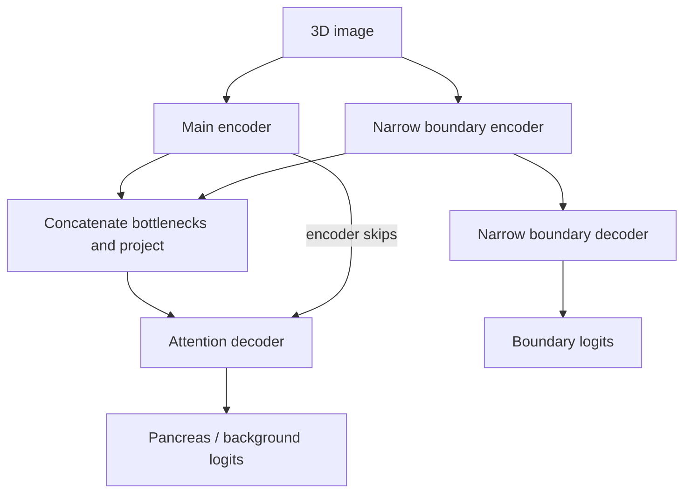

# Boundary encoder: where each tensor goes

The masks are **targets only**. They never enter either encoder or any gate.
At training time, ground-truth labels are also used to sample positive
patches, as is usual for supervised segmentation.

For the default 96x96x96 patch, ignoring the batch axis:

| Stage | Main stream | Boundary stream |
|---|---|---|
| Input | 1 x 96 x 96 x 96 | same image |
| Encoder level 0 | 16 x 96 x 96 x 96 | 8 x 96 x 96 x 96 |
| Level 1 | 32 x 48 x 48 x 48 | 16 x 48 x 48 x 48 |
| Level 2 | 64 x 24 x 24 x 24 | 32 x 24 x 24 x 24 |
| Level 3 | 128 x 12 x 12 x 12 | 64 x 12 x 12 x 12 |
| Bottleneck | 256 x 6 x 6 x 6 | 128 x 6 x 6 x 6 |
| Fused bottleneck | (256 + 128) -> 256 channels | separate boundary features remain available |
| Output | 2 x 96 x 96 x 96 | 1 x 96 x 96 x 96 |

The 1x1x1 fusion projects the concatenated bottleneck back to 256 channels.
Therefore the original decoder and gate widths can be retained. Boundary
information still reaches later gating signals through the decoder.

## Training objective

`total_loss = segmentation_loss + boundary_weight * boundary_loss`

- Segmentation loss: soft multiclass Dice over the two classes by default;
  optional cross-entropy can be mixed in using `ce_weight`.
- Boundary loss: weighted binary cross-entropy **on boundary logits**,
  compared with a thin inner boundary extracted from the binary pancreas
  target. `boundary_pos_weight` compensates for sparse positive voxels.
- The boundary loss updates the boundary encoder and its decoder/head.
- The segmentation loss updates the main stream, fusion, and boundary
  encoder. It gives the new features a reason to help pancreas segmentation.
- The separate branch is encouraged to encode useful boundary information;
  its hidden channels are not guaranteed to represent only boundaries.

No hard threshold is applied to network outputs before computing losses.
The erosion operation generates fixed ground-truth targets outside autograd,
so it does not need to be differentiable.

## Inference

The boundary encoder and bottleneck fusion remain active. Only the auxiliary
boundary decoder/head can be skipped, since segmentation does not consume
their predictions. Full volumes are reconstructed with Gaussian-weighted
sliding-window inference, followed by argmax over the two class logits.

## Scope of the comparison

The primary comparison is `attention_unet` versus
`boundary_attention_unet`. An ungated `unet` control is also available.

This comparison tests the combined benefit of extra capacity, boundary
supervision and bottleneck fusion. Record parameter count, runtime and memory
as well as segmentation metrics. It does not isolate the contribution of
each individual component, and a numerical improvement is not guaranteed.

